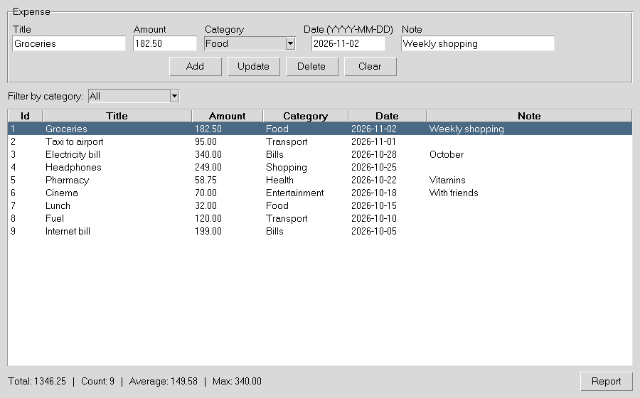
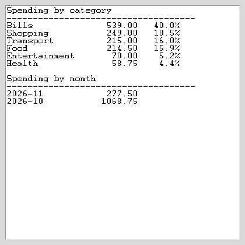

# Expense Tracker

A desktop app to record expenses, categorize them, and see spending reports.
Built with **Python**, **Tkinter**, and **SQLite**.

## Screenshots
Main window (add / edit / delete, filter, totals):



Report window (by category and by month):



## Features
- Add, edit, delete expenses (full CRUD)
- Categories and category filter
- Summary bar: total, count, average, max
- Reports: spending by category (with %) and by month
- Data saved in a local SQLite file (`expenses.db`)
- Input validation (positive amount, required title)
- Unit tests for the database layer

## Run
```bash
python app.py
```
Tkinter ships with Python. On Linux you may need: `sudo apt install python3-tk`.

## Test
```bash
python -m unittest -v
```

## Structure
| File | Purpose |
|------|---------|
| `database.py` | SQLite layer: CRUD + report queries |
| `app.py` | Tkinter GUI |
| `test_database.py` | Unit tests |

## Skills shown
Python, SQLite, SQL aggregation (`GROUP BY`), CRUD, GUI design, unit testing.
